<div align="center">


<br/>

<a href="https://www.linkedin.com/in/tunguyenn99"></a>
<a href="https://tunguyenn99-portfolio.vercel.app/"></a>
<a href="mailto:tunguyen150599@gmail.com"></a>
<a href="https://www.facebook.com/groups/xomdata"></a>

</div>

<br/>




<br/><br/>


<br/><br/>


<p align="center">
  <sub>
    <a href="https://www.gpbank.com.vn/">GPBank</a> ·
    <a href="https://hvgroup.com.vn/">HV Holdings</a> ·
    <a href="https://upbase.asia/">UpBase</a> ·
    <a href="https://www.tnex.com.vn/">TNEX Finance</a> ·
    <a href="https://vnpay.vn/">VNPAY</a> ·
    <a href="https://shopee.vn/">Shopee</a> ·
    <a href="https://www.facebook.com/groups/xomdata">Xóm Data</a> ·
    <a href="https://mindx.edu.vn/">MindX</a>
  </sub>
</p>

<br/>


<!--START_SECTION:projects-->
<table align="center">
  <tr>
    <td width="50%"><a href="https://github.com/tunguyenn99/thu_vien_cua_xom_data"></a></td>
    <td width="50%"><a href="https://github.com/tunguyenn99/data-road-map-by-roles"></a></td>
  </tr>
  <tr>
    <td width="50%"><a href="https://github.com/tunguyenn99/crawl-topcv-jobs"></a></td>
    <td width="50%"><a href="https://github.com/tunguyenn99/dbt-trino-minio-iceberg-mage"></a></td>
  </tr>
  <tr>
    <td width="50%"><a href="https://github.com/tunguyenn99/distributed-data-processing"></a></td>
    <td width="50%"><a href="https://github.com/tunguyenn99/son-tung-mtp-analytics"></a></td>
  </tr>
</table>
<!--END_SECTION:projects-->

<p align="center"><sub><a href="https://github.com/tunguyenn99?tab=repositories&sort=stargazers">→ all repositories</a></sub></p>

<br/>


<br/><br/>


<div align="center">
  
</div>

<table align="center" border="0">
  <tr>
    <td width="50%" valign="top"></td>
    <td width="50%" valign="top"></td>
  </tr>
</table>

```sql
-- models/marts/fct_weekly_coding.sql  ·  refreshed daily by GitHub Actions
SELECT language, time_spent, intensity_bar, pct_of_total
FROM   {{ ref('stg_wakatime__last_7_days') }}
ORDER  BY time_spent DESC;
```

<!--START_SECTION:waka-->

```txt
No activity tracked
```

<!--END_SECTION:waka-->

<br/>


<details>
<summary><code>▸ SELECT * FROM tu_nguyen.secrets;</code> <sub>← click to run</sub></summary>

```json
{
  "status": 200,
  "data": {
    "availability": "Open for Collaboration",
    "hobbies": ["Data Storytelling", "Automating Everything", "Modern Data Stack"],
    "favorite_stack": ["dbt", "Airflow", "Power BI"],
    "coffee_conversion_rate": "1 cup ➔ 1000 lines of code",
    "fun_fact": "Started with Chemistry, now bonding with Data Points"
  }
}
```

<sub>✓ 1 row returned in 0.042s · cache hit</sub>

</details>

<br/>


